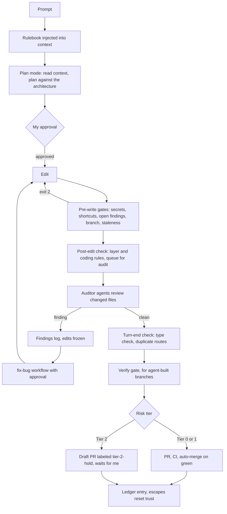

# The AI Development Workflow Behind KAPI

By Avdhesh Bansal. October 2026.

This is the design doc for how a change moves from idea to merged code on KAPI Cars, when Claude Code agents do much of the writing. The research report is in [README.md](README.md). This document is the mechanics.

In short, one rulebook goes into every prompt. Scripts check every write before and after it lands. Read-only auditor agents log findings to a shared file. An open finding freezes unrelated work until a fix is approved and verified. Risky changes wait for me.

## 1. The life of a change

### Step by step

1. **Session start.** Claude Code loads the project instructions. They tell every session to read the project context, the roadmap, and the engineering journal before changing anything.
2. **Prompt.** A hook injects the full rulebook into the prompt. A second hook warns, without blocking, if the working branch has fallen behind the shared integration branch.
3. **Plan mode.** Every code-changing workflow starts in plan mode. The plan must follow Clean Architecture (domain, application, infrastructure, API) and SOLID. Subagents cannot enter plan mode, so for them the written brief is their authorization.
4. **Approval.** I approve the plan. Nothing changes before that.
5. **Edit.** Usually the main session, running a skill. For parallel work, builder agents (section 6).
6. **Pre-write gates.** Four scripts run before every write. Any of them can refuse it with exit code 2. They block secrets and unjustified shortcuts, unrelated edits while a finding is open, writes after another session switched the branch, and writes on a branch that is too far behind. A fifth hook blocks any read of environment secret files.
7. **Post-edit check.** After each edit, a script checks layer rules and coding rules. It logs violations to the findings log and queues the file for the architecture auditor.
8. **Auditors.** Code-changing skills must run the architecture auditor on the changed files. Domain auditors are matched to the type of bug, for example the payments auditor for money code and the tenant-isolation auditor for tenant code.
9. **Turn end.** When the agent tries to finish a turn, a hook runs the type checker once per affected workspace and a duplicate-route check if a controller changed. On failure it refuses to end the turn once, so the agent has to keep fixing. It will not block twice in a row, to avoid a loop.
10. **Verify gate.** For branches built by builder agents, the gate re-runs the shortcut scan over the whole diff, the type checker, and the module tests, and requires the architecture auditor to approve. Tier 2 adds the payments, tenant-isolation, and penetration auditors.
11. **Risk tier.** Tier 0 and Tier 1 open normal pull requests. Tier 2 opens a draft labeled `tier-2-hold`.
12. **PR and CI.** Six GitHub Actions workflows run (section 8). A guard fails any pull request that does not target an integration branch.
13. **Merge and ledger.** The design records each shipped change with its tier, its verify verdict, and whether a defect escaped later. An escape resets the trust streak and goes to the fix-bug workflow.

## 2. Hook reference

There are 12 hook scripts. Eleven are wired to lifecycle events. One is a helper. A separate background job refreshes the integration-branch pointer every five minutes for the staleness checks.

| Hook | Event | What it does | If its tools break | Why it exists |
|---|---|---|---|---|
| inject-arch-context | Every prompt | Injects the rulebook | Falls back to a short rule set | One source of truth for all agents |
| freshness-check | Every prompt | Warns if the branch is behind | Silent | Parallel sessions kept working on stale bases |
| protect-env | Before reads and shell commands | Blocks any access to environment secret files | Fails open | Those files hold database, API, and Stripe keys |
| pre-write-scan | Before writes | Blocks secrets, no bypass. Blocks type escapes, disabled lint rules, and known shortcuts unless the line has a written reason | Fails open | Stop bad code before it reaches disk |
| gate-edits-on-blockers | Before writes | Freezes unrelated edits while a blocking finding is open in this worktree | Fails open on a broken log. Fails closed on unknown severity. | The closed loop |
| gate-edits-on-branch-pin | Before writes | Blocks writes if the branch changed underneath the session | Fails open | On 2026-07-03 one task's edits landed on another task's branch |
| gate-edits-on-staleness | Before writes | Blocks writes on a branch too far behind. Docs are never blocked. Mobile and e2e paths get a higher threshold. | Fails open, with a manual override file | Broken rebases from parallel sessions |
| post-edit-check | After edits | Logs layer and coding violations and queues the file for audit. Never blocks. | Skips logging | Content check. Slow checks moved to turn end. |
| pin-branch-update | After shell | Records the intended branch after the session's own checkout or merge | Fails open | Companion to the branch pin |
| subagent-context | Subagent start | Injects the rulebook and that agent's context section | Reduced context | A subagent starts empty |
| turn-end-check | Turn end | Type check and duplicate-route check, blocks the turn end once | Allows | Per-edit checks raced multi-file refactors and raised false findings |
| clear-blocker | Helper, allow-listed | Clears findings surgically, by fix-bug, or all | Exits on a missing tool | Avoids granting a broad file permission just to edit the log |

## 3. Skills versus agents

The routing rule is short. Code-changing work runs as skills in the main session, under plan mode and my approval. Auditors run as agents, read-only, in isolated context. A code-changing subagent is a category mistake. It cannot enter plan mode, and it cannot stop to ask for approval halfway through a change.

The repo shows the rule in practice. A module migrator, an end-to-end spec generator, and a roadmap autopilot all started as agents and were converted to skills. Read-only orchestrators such as the gate-check skill and the migration-complete check are also skills, for a different reason. Agents cannot spawn agents, so a battery of auditors has to be fanned out from the main session.

All 15 auditor agents pin the same model, and so does the builder agent definition. That keeps behavior consistent. It also means the auditors share the builder's blind spots, which the research report discusses.

## 4. Context engineering

Each agent gets only what it needs.

- **Main session.** The full rulebook on every prompt, plus the project instructions that Claude Code loads by default.
- **Subagents.** A header naming the agent type, the rulebook, and the agent's own section from a context registry. The registry sets a limit of about 2,500 characters per agent for rules specific to its job.
- **A hard cap for subagents.** Subagent context is capped at 9,800 characters, just under the 10,000 limit for injected context. If it runs over, the agent's own section is dropped first, then the rulebook is truncated with a warning.
- **No teaching material.** The engineering journal explains why decisions were made. It is not injected into working agents. An agent needs the current rule, not its history. When a lesson becomes a rule, it moves into the rulebook. Everything else is read on demand.

## 5. The closed loop

The findings log is a JSON list. Each entry has a file, a line, a rule with the severity as a prefix (for example `BLOCKING:clean-arch-layer`), a source, a message, an optional worktree tag, and a timestamp. The post-edit check, the turn-end check, and the architecture auditor all write to it.

The freeze works in this order.
1. Writes outside the project are never gated.
2. An empty log allows everything.
3. Editing the flagged file or its test is allowed, so the fix can land.
4. While a fix-bug run is active, edits are allowed and logged as drift. The active marker expires after 60 minutes.
5. Otherwise the gate counts open findings whose severity is not suggestion, info, or minor. Any unknown severity counts as blocking. A finding with no worktree tag counts against the current worktree.
6. If any remain, the write is refused with instructions to enter plan mode and run fix-bug.

Clearing happens only inside fix-bug. It marks itself active, clears the target finding so it can write its own plan, fixes the cause, re-runs the type checker and the post-edit checks, and clears the entry. If the fix created new findings, it recurses. At depth three it stops and records technical debt. If a fix is abandoned, the next edit logs the violation again, so the loop heals itself. Every clear is written to a log. As of 2026-10-15 it shows 413 remediated findings.

The severity policy changed once. In May an agent treated a SERIOUS finding as safe to defer, so I made every finding block. By July that caused too much friction, so suggestion, info, and minor became advisory. Everything else still blocks.

## 6. Parallel builds (build-wave)

Build-wave runs several workstreams at once, each built by a builder agent in its own git worktree.

- **Before launch.** Each workstream has an approved plan with scope, an exact list of files it may touch, a tier, and acceptance criteria. Any workstream whose files overlap work in flight is refused. The findings log must be empty.
- **The base-branch trap.** New worktrees start from the default branch, which was hundreds of commits behind the integration branch. That tripped the staleness gate and deadlocked builders. So each builder's first action is to check out a `build/` branch from the integration head. The `build/` prefix is what the staleness hooks exempt.
- **Builder rules.** Stay inside the worktree. Never bypass a hook. Never use the staleness override. Never take a tenant ID from a request body. These rules exist because builders broke each of them once.
- **Verify gate.** Shortcut scan over the diff, type check, module tests, and an architecture auditor approval, with domain auditors for higher tiers. Two fix attempts, then a draft PR labeled `needs-fix-bug`.
- **Ship.** Tier 0 and 1 merge when CI passes. Tier 2 opens as a draft labeled `tier-2-hold`.
- **Ledger.** Each ship appends an entry. Five clean Tier 0 or Tier 1 entries in a row would unlock Tier 2 auto-merge, and any escape resets the count. The ledger currently holds one entry, so this has not been exercised.
- **The documented failure.** On 2026-06-09 and 10, three waves of code builders failed. One made zero commits, two stalled for 10 to 22 minutes. The worktrees had no installed dependencies. The runner killed any agent idle for more than 180 seconds during a test run. One builder edited files in the main repo instead of its worktree. The cost was about 2.3 million tokens for a single docs pull request. Worktree builders are now limited to read-only recon and docs. Code runs in the main session.
- **Cross-worktree deadlock.** One builder's finding once froze its siblings. The fix was to tag every finding with its worktree.

## 7. Release gates

Before a launch milestone, the gate-check skill runs a battery of auditors for that gate and maps their findings to the launch checklist. It returns GO or NO-GO. It refuses to run if the local stack is down, because the live auditors need a running app and database. A cross-tenant leak is an automatic NO-GO. A separate read-only skill answers whether the old Express backend can be deleted. It reports anything it cannot verify as needing human verification and never passes it silently.

## 8. CI workflows

| Workflow | Trigger | What it gates |
|---|---|---|
| CI | Pushes and PRs to the integration branches | Dependency audit that fails on high or critical advisories outside a short documented allowlist, then frontend and API builds and tests against a Postgres service |
| Security | Dependency changes and a weekly schedule | OWASP ZAP baseline scan against the running stack |
| SEO quality | PRs that touch the frontend | Lighthouse budgets and structured-data validation |
| PR base guard | PR opened or updated | Fails unless the base is an integration branch |
| Claude code review | PR opened or updated | Automated review by Claude |
| Claude on demand | Mentions in issues and PRs | On-demand agent with a Postgres service |

The tenant-isolation end-to-end suites run as the restricted database role, so a leak fails the build.

## 9. Known gaps

I keep a list of where the system does not yet match its own design.
- The architecture auditor's instructions still say every severity blocks. The gate now lets minor findings through.
- Some hooks fail open when a dependency is missing.
- A title tag meant to skip automated review on docs PRs is not enforced by the review workflow.
- The autonomy ledger lives in one worktree with one entry.
- The live attack battery has not yet run as a formal release gate.
- Some internal docs have stale counts and line references. The code is the source of truth.

Each gap is either a design choice I made on purpose or a task on the list.
